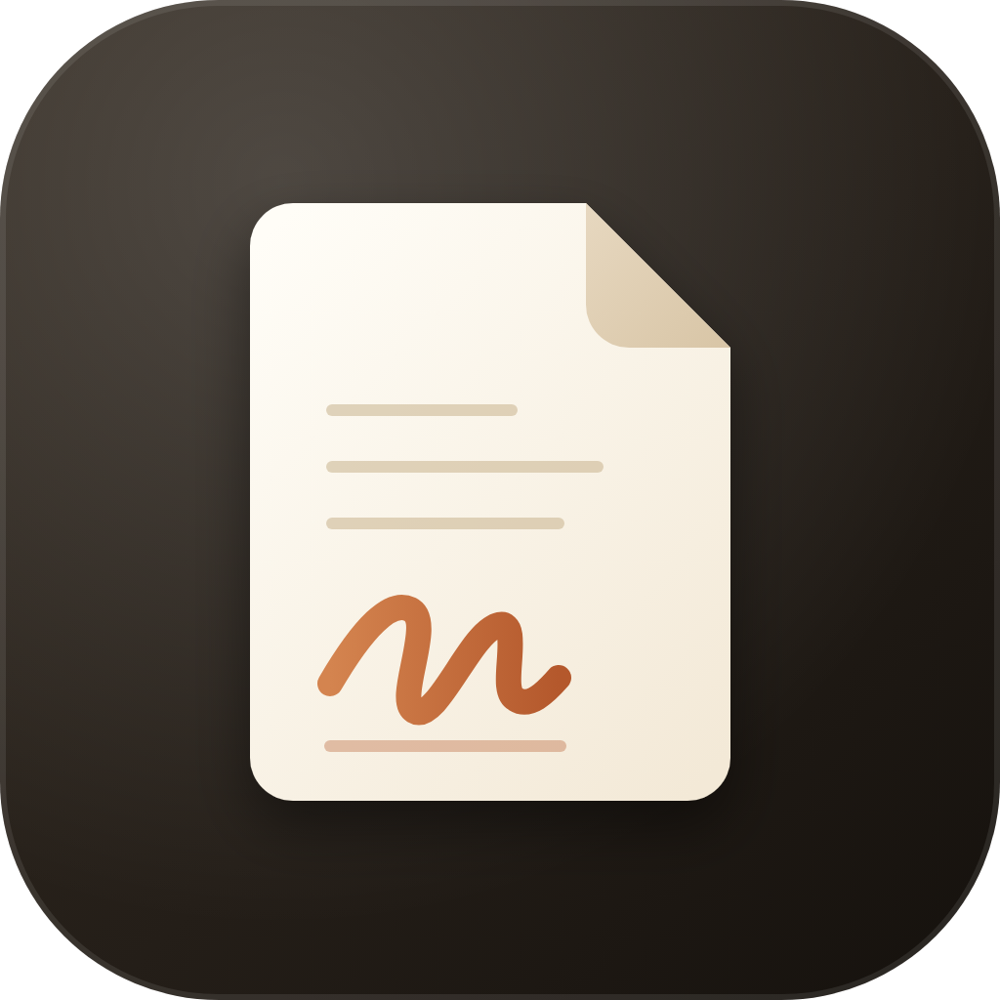
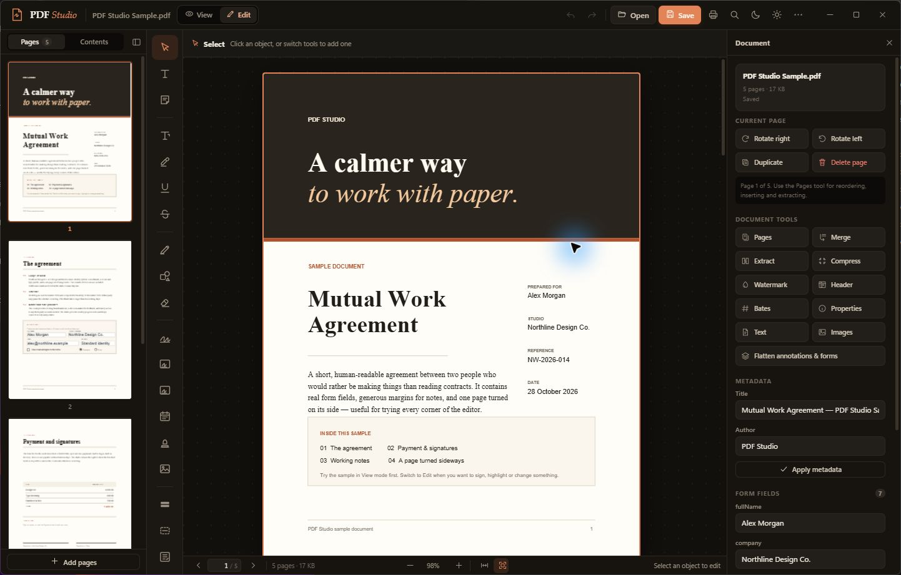
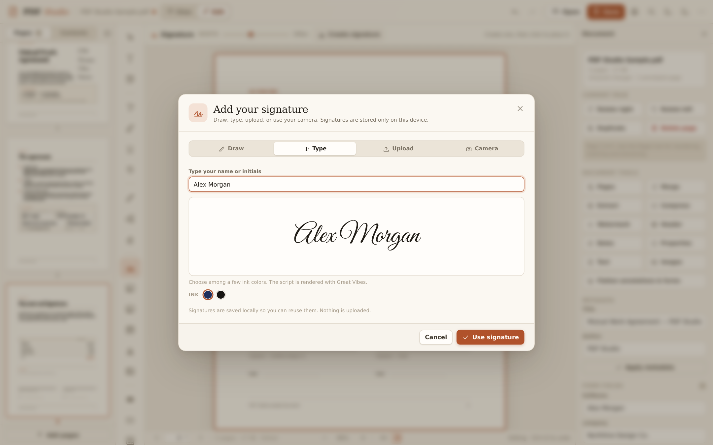
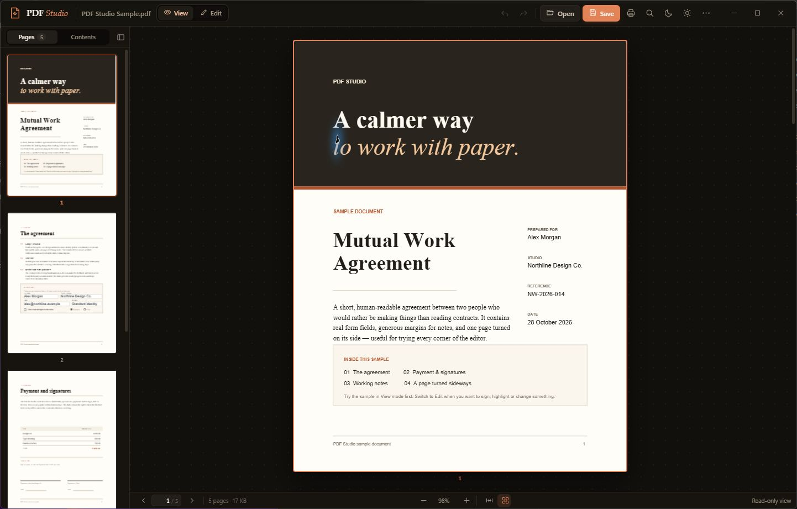

<div align="center">
  

# PDF Studio

**Read it. Sign it. Make it yours.**

A desktop PDF reader and editor for Windows, macOS, and Linux. Read documents, add a signature in a few clicks, fill forms, and keep your work on your own computer.

[Get started](#get-started) · [Features](#features) · [Screenshots](#screenshots) · [Building](#build-a-portable-app) · [Support the project](#support-pdf-studio)

</div>



## Features

- **Read and navigate:** continuous scrolling, thumbnails, document outlines, text selection, search, zoom and dark-paper mode.
- **Annotate:** highlight, underline, draw, add shapes, notes, stamps, images and text boxes.
- **Sign and fill:** draw, type, upload or capture a signature; fill supported PDF form fields.
- **Organize:** rotate, reorder, insert, duplicate, extract or delete pages, and merge PDFs.
- **Prepare and export:** add watermarks, headers, footers and Bates numbers; export text or page images.

PDF Studio runs locally. Documents and saved signatures stay on your computer. Opening the optional donation link or a link in a PDF uses your web browser.

## Add your signature

1. Open a PDF and switch to **Edit**.
2. Choose **Signature** in the left toolbar, then click where it belongs on the page.
3. Draw, type, upload an image, or capture your signature with a camera. Select **Use signature**, then move or resize it on the page.
4. Save the document. Your signature is stored locally for reuse, and you can delete it from the signature dialog.



These are visual electronic signatures. PDF Studio does not create certificate-based digital signatures or verify document authenticity. Saved signatures are stored locally in the app's profile, without separate encryption.

## Screenshots

<details>
<summary>See the reading view</summary>



</details>

The screenshots show the included fictional sample document. Its fifth page is deliberately rotated 90 degrees to demonstrate handling of rotated pages.

## Get started

### Downloading a build

Download the archive for your operating system from the [Releases page](https://github.com/kingrebelf/PDF-Studio/releases), extract it, and open the application inside. These are portable builds, so no installer is needed. If no build is available for your platform, follow the source instructions below. The `PDF-Studio-1.0.0-source.zip` file is an older snapshot; use the main branch for current source.

### Run from source

Install [Node.js](https://nodejs.org/) 22.12 or later and Git, then run:

```bash
git clone https://github.com/kingrebelf/PDF-Studio.git
cd PDF-Studio
npm ci
npm start
```

Choose **Continue to PDF Studio** on the startup screen, then open a PDF or select **Try the sample**. The donation button is optional and opens Stripe in your browser.

### Build a portable app

After running `npm ci`, use the command for your platform:

| Platform | Command | Launch from the generated folder |
| --- | --- | --- |
| Windows x64 | `npm run package:win` | `PDF Studio.exe` |
| Linux x64 | `npm run package:linux` | `./PDF\ Studio` |
| macOS Apple silicon | `npm run package:mac` | `PDF Studio.app` |
| macOS Intel | `npm run package:mac-intel` | `PDF Studio.app` |

Output is placed in `release/`. These commands produce portable application folders, not system installers. Platform builds are unsigned, so the operating system may display a warning. Build and test on the target platform before distributing; cross-platform packaging may require additional tools.

## Using PDF Studio

1. Open a document or try the sample.
2. Use **View** to read, search and navigate. Switch to **Edit** to use the tool rail and properties panel.
3. Save your work, or use **Save a copy** to keep the original.

Common shortcuts use Ctrl on Windows/Linux and Command on macOS:

| Action | Shortcut |
| --- | --- |
| Open / save | `Ctrl` + `O` / `Ctrl` + `S` |
| Save a copy | `Ctrl` + `Shift` + `S` |
| Find / print | `Ctrl` + `F` / `Ctrl` + `P` |
| Undo / redo | `Ctrl` + `Z` / `Ctrl` + `Shift` + `Z` |
| Zoom in / out / actual size | `+` / `-` / `0` |
| Pan | Hold `Space` and drag |

For the complete shortcut list, use the app's **More** menu.

### Saving and redaction

Edits are overlays until saved. Pages with redactions are rasterized so their original page content is not retained as searchable text on those pages; annotated rotated pages may also be rasterized. This can change text selectability and image quality. Redaction does not automatically sanitize metadata, attachments, other pages, or all hidden document information. Inspect and independently verify the saved copy before sharing sensitive information.

## Development

```bash
npm run check
npm test
npm audit
```

The static check parses application modules, checks named imports and verifies required assets. The regression test opens the app in an isolated profile and checks signatures, redaction output and save behavior. Linux requires a graphical display (or `xvfb-run -a npm test`). See [CONTRIBUTING.md](CONTRIBUTING.md) for the project layout, testing and contribution guidance. Automated checks and platform packaging are configured in GitHub Actions.

## Support PDF Studio

If PDF Studio is useful to you, you can [support its development with a donation](https://buy.stripe.com/4gMaEZbjc0cd23293U9IQ00). Donations are optional.

## License and credits

PDF Studio is available under the [MIT License](LICENSE). It uses [Electron](https://www.electronjs.org/), [PDF.js](https://mozilla.github.io/pdf.js/), [pdf-lib](https://pdf-lib.js.org/) and the Great Vibes font. Third-party components retain their respective licenses; the font license is included in `app/assets/GreatVibes-OFL.txt`.
